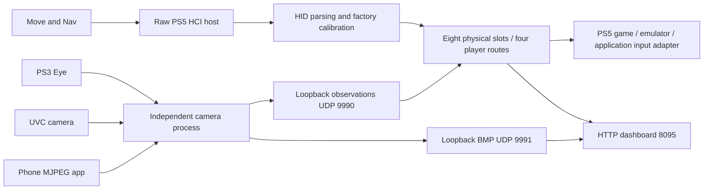

# Architecture

The main process owns the dashboard, HCI host, USB registration worker and player routing. The camera process independently publishes normalized observations and previews. A stop marker coordinates camera shutdown. Emulators consume loopback input; they should leave camera/Bluetooth ownership to the producer.

The raw HCI host currently interferes with Sony-native reconnection. PoorDS4's native input API architecture is different; its success does not establish safe raw-HCI coexistence.

| Source | Responsibility |
| --- | --- |
| src/hci_usb.c | USB descriptors, endpoints, transfer queues |
| src/host.c, host_int.h, le.c | HCI/L2CAP/SDP/HID, link ownership |
| src/profiles.c | Move/Nav input and output report formats |
| src/players.c | Persistent identities, assignments and offline role release |
| src/usb_register.c | USB identity/calibration, Nav host backup/readback, notifications |
| src/move_bridge.c | Calibrated Move publication and attached optics |
| src/nav_bridge.c | Four Nav output channels |
| src/move_config.c | Proposed virtual layouts and motion-to-stick mapping |
| src/ps5_vpad.c | Guarded virtual-pad backend; native startup stage logging |
| src/web.c, web/index.html | API and embedded UI; src/web_page.c is generated |
| camera/eye-optical-bridge.c | Camera lifecycle, Eye stream and normalized reporting |
| camera/uvc-camera.c, ps5-usb.c | libuvc/Sony USB adapter and bounded JPEG decoding |
| camera/phone-camera.c, mjpeg-stream.h | Local HTTP phone camera and chunked multipart framing |
| camera/eye-multisphere.h | Color components, shape scoring, ignored regions |

## Runtime paths

These are path descriptions, not permission to publish a user's files.

- `/data/move-studio/`: bridge.log, bridge.pid, players.ini, layouts.ini, usb-registration.log, camera.json, phone-camera.url, camera-exclusions.ini.
- `/data/anypad-move-nav/`: anypad.lock, pads.db, per-identity calibration, Nav identity/original-host backups and local-address.bin.
- `/data/move-studio/enable-experimental-virtual`: guarded compatibility experiment; absent in normal operation.

Registration is not connection. Offline records retain a preferred player but release live hand roles. Physical slots can be reused by different identities. Use address-based dashboard operations and explicit connection generations/freshness in consumers.
